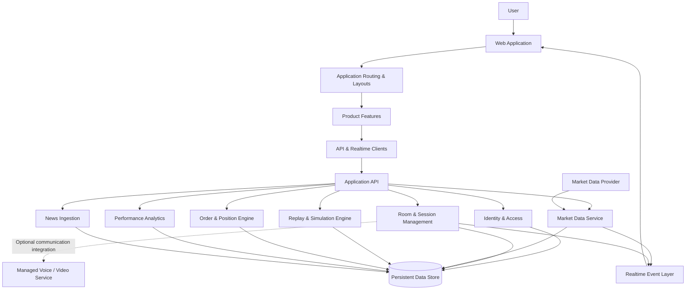
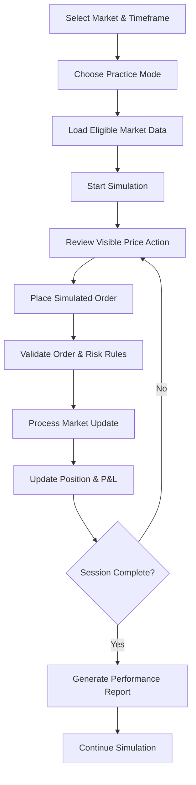

# ChartWars

### A Competitive Trading Simulation & Market Learning Platform

**Practice the market. Master the process. Compete on your decisions.**

ChartWars is a trading simulation platform designed to make market practice more structured, measurable, and competitive. It brings historical market replay, simulated trading, multiplayer challenges, and performance analysis into one cohesive experience.

The objective is simple: create an environment where users can develop trading skills, test strategies, compete with friends, and evaluate decisions — without putting real capital at risk.

> **Product focus:** Market simulation · Competitive learning · Risk management · Performance analytics

---

## Product Vision

Most trading tools focus on displaying market information. ChartWars focuses on what users do with it.

The platform is designed around four core principles:

- **Practice over prediction** — learn by interacting with historical market conditions rather than relying solely on theoretical examples.
- **Competition with context** — compare decisions and outcomes in structured challenges.
- **Risk before reward** — evaluate exposure, drawdown, and execution discipline alongside profitability.
- **Progress that can be measured** — turn trading sessions into meaningful performance insights.

ChartWars is a simulation and educational project, not a brokerage, investment advisory service, or guarantee of trading performance.

---

## The Product

| Experience | Purpose |
|---|---|
| **Market Replay** | Explore historical price action and make decisions one candle at a time. |
| **Trading Simulator** | Practise entries, exits, position sizing, stop-losses, and take-profit levels. |
| **Friend Rooms** | Participate in shared trading sessions with room-based access and permissions. |
| **Competitive Challenges** | Compare simulated outcomes through structured rounds and defined rules. |
| **Blind Rounds** | Evaluate decisions against hidden future price action before the reveal. |
| **Coach Mode** | Practise against rule-based strategy behaviour and learn from different market scenarios. |
| **Performance Reports** | Review returns, win rate, risk-to-reward, drawdown, and decision discipline. |
| **Learning & Market News** | Access educational material and relevant market coverage in one place. |

*The table describes the intended product scope. Availability depends on the current implementation.*

---

## System Architecture

ChartWars is organised around clear boundaries between the user experience, application services, market data, and simulation logic.



**Architecture note:** This diagram represents the target system architecture. Services shown here should not be interpreted as already implemented or deployed.

### Architectural principles

- **Separation of concerns:** UI components, product features, application services, and domain logic have distinct responsibilities.
- **Explicit boundaries:** Authentication, room permissions, market data, order execution, and analytics are treated as separate concerns.
- **Server-authoritative simulation:** In competitive modes, the server must validate orders and permissions and control access to hidden future market data.
- **Reusable domain logic:** Order execution and performance calculations should be testable independently of the UI.
- **Incremental delivery:** Each feature should be developed, validated, and integrated in a controlled sequence.

---

## Trading Simulation Lifecycle



The intended lifecycle separates market-data playback from order validation and performance calculations. This separation helps keep simulation results consistent and makes the core trading logic easier to test.

---

## Frontend Structure

```text
apps/
└── web/
    └── src/
        ├── app/
        │   ├── App.jsx
        │   ├── router.jsx
        │   └── providers/
        ├── components/
        │   ├── ui/
        │   ├── common/
        │   └── layout/
        │       ├── header/
        │       ├── footer/
        │       ├── sidebar/
        │       └── bottom-nav/
        ├── features/
        │   ├── auth/
        │   ├── markets/
        │   ├── rooms/
        │   ├── friends/
        │   ├── replay/
        │   ├── orders/
        │   ├── coach/
        │   ├── blind-round/
        │   ├── learn/
        │   ├── news/
        │   └── analytics/
        ├── layouts/
        ├── pages/
        │   ├── landing/
        │   ├── auth/
        │   ├── dashboard/
        │   ├── markets/
        │   ├── rooms/
        │   ├── friends/
        │   ├── learn/
        │   ├── news/
        │   ├── profile/
        │   └── settings/
        ├── hooks/
        ├── services/
        ├── lib/
        ├── utils/
        ├── constants/
        └── styles/
```

### Frontend organisation

- **`app/`** — application entry, routing, and shared providers.
- **`components/ui/`** — reusable interface primitives.
- **`components/layout/`** — shared navigation and page structure.
- **`features/`** — feature-specific UI, hooks, and service logic.
- **`pages/`** — route-level screens.
- **`services/`** — shared communication with external services.
- **`lib/` and `utils/`** — reusable infrastructure and helper functions.
- **`styles/`** — global styling and design foundations.

This structure is intended to keep product features modular as the application grows.

---

## Engineering & Reliability

ChartWars is being designed with attention to correctness, predictable behaviour, and maintainability.

### Simulation integrity

- Validate order inputs and enforce trading rules consistently.
- Keep hidden future candles inaccessible during replay and blind challenges.
- Calculate positions, realised and unrealised P&L, and risk metrics through defined rules.
- Prevent unauthorised participants from executing privileged room actions.
- Keep competitive results derived from validated simulation state.

### Security boundaries

- Validate incoming data at application boundaries.
- Protect authenticated routes and sensitive session operations.
- Apply rate limits to abuse-prone endpoints.
- Keep secrets and provider credentials outside version control.
- Enforce access control on the server rather than relying on hidden or disabled UI controls.

### Testing strategy

Priority areas for automated tests include:

- Order execution and position accounting.
- Replay progression and future-data isolation.
- Room membership and role-based permissions.
- Invalid, duplicated, and unauthorised requests.
- Performance metric calculations.

Testing claims and coverage should reflect the tests that are actually present and passing in the repository.

---

## Development Roadmap

### Foundation
- [ ] Establish the responsive application shell.
- [ ] Build the landing page and navigation system.
- [ ] Create reusable design components and page layouts.
- [ ] Add route-level loading, empty, and error states.

### Market Experience
- [ ] Integrate historical candle data.
- [ ] Implement chart interactions and timeframe selection.
- [ ] Develop replay controls and deterministic progression.
- [ ] Add simulated orders, positions, and risk controls.

### Social & Competitive Experience
- [ ] Add identity and friend workflows.
- [ ] Introduce rooms, invitations, and access permissions.
- [ ] Develop competitive rounds and blind challenges.
- [ ] Add optional voice/video integration.

### Insight & Delivery
- [ ] Build performance reports and risk analytics.
- [ ] Integrate curated market news and learning resources.
- [ ] Expand automated security and simulation tests.
- [ ] Document deployment, operational limits, and architecture decisions.

---

## Local Development

### Prerequisites

- Node.js
- pnpm

### Run the frontend

From the repository root:

```bash
pnpm install
pnpm dev
```

The development server should print the local URL when it starts.

### Create a production build

```bash
pnpm build
```

### Project boundaries

The repository is organised as a monorepo so that the web application and future application services can evolve independently.

```text
ChartWars/
├── apps/
│   ├── web/     # Active frontend application
│   └── api/     # Reserved for future backend development
├── packages/    # Shared code, when needed
├── docs/        # Architecture and engineering documentation
└── scripts/     # Development and maintenance utilities
```

The backend is not considered operational until its implementation, configuration, and tests are available.

---

## Design Direction

The interface aims for a focused, high-contrast trading environment with:

- A dark visual foundation and subtle grid details.
- Clear market information hierarchy.
- Restrained green and red state indicators.
- Responsive desktop navigation and mobile-first interaction patterns.
- Consistent spacing, typography, and reusable interface components.
- Deliberate loading, empty, success, and error states.

The goal is to keep attention on market behaviour, decisions, and results rather than unnecessary visual noise.

---

## Project Status

**Status:** In active development.

ChartWars is being built incrementally, starting with the frontend foundation and progressing toward a complete market simulation experience. Features listed in the product scope and roadmap may not yet be available.

As implementation progresses, this README will be updated with verified screenshots, working functionality, test results, setup instructions, and deployment details.

---

## Disclaimer

ChartWars is intended for educational and simulated trading practice. It does not execute real trades, provide investment advice, or guarantee financial results. Market data availability and accuracy may depend on external providers.

---

**Built with a focus on disciplined practice, reliable simulation, and measurable improvement.**